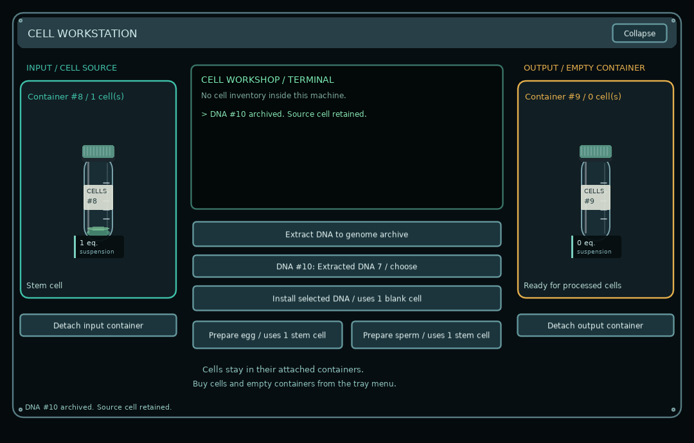

# Cellarium: Physical Cell Workshop

Desktop laboratory development branch. The cell workshop now processes physical attached containers, with a terminal for results and no internal cell inventory.

[Download the complete Windows build](builds/Cellarium-Cell-Workshop-Windows.zip). Extract it and open **Cellarium-Cell-Workshop.exe** with the DLLs beside it. Exit any older Cellarium desktop build through its tray icon first.

## Use the new system

1. A new experiment starts with no cells. Right-click the Cellarium tray/taskbar icon > **Buy supplies…**.
2. Buy one ordinary or blank cell for **1 credit**, supplied in its own vial. Separately purchased containers arrive empty.
3. Click the workstation to open its desktop controls. Drag a cell container onto **INPUT** and an empty container onto **OUTPUT**.
4. Extract DNA into the genome archive, install archived DNA using one blank cell, or prepare one egg/sperm precursor using one stem cell. Results go to the attached output; messages appear on the terminal. Extraction retains its source and needs no physical output.
5. Cultivate inside the containers and transfer with the dropper. Freeze a loaded dropper's contents through its context menu. Retrieve samples into containers through the tray/dropper frozen-storage menu.

Read the [complete workshop guide](docs/CELL_WORKSHOP_GUIDE.md) for docking, the Forge-to-workshop workflow, incubation, preservation and migration. The [delivery report](CELL-WORKSHOP-REPORT.md) records actual tests and limitations.

## Compatibility and verification

Existing specimens are preserved and moved from loose stock into physical vials. Existing organism anatomy is retained. If an older save restores stock, use Settings > Start a new experiment to see the new cell-free starting state. Desktop persistence, PC-linked life timing, Fahrenheit display and right-click context menus remain.

Executed: **26 workshop groups, 65 desktop/native groups, and 30 reconstruction regression groups passed**. The native checks include actual Windows-event docking and direct workshop operations. The old monolithic tests.lua baseline assertion documented in prior revisions is not included among these passes.

Anatomical research and its historical development artifacts remain in the repository. The current cell-workshop instructions supersede older descriptions of loose-cell inventories and workshop cultivation controls.
