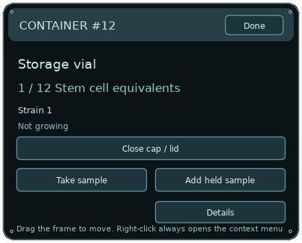

# Cellarium — Windows Desktop Laboratory

The main branch now contains the desktop laboratory, including PC-linked life timing and continuous fed cultures. Experimental anatomy changes are developed separately on anatomy-dev. Native Windows equipment is the default; the classic interface is available only through **Settings → Classic interface**.

## How to use the new system

Start with the **[Desktop Laboratory User Guide](docs/USER_GUIDE.md)**. It explains the current controls, individual containers, sample transfers, workstation, Forge, saving and recovery. Each physical vial shows only its own contents; source selectors belong to central tools, not vial panels.



## Launch

Exit any older desktop laboratory through its tray menu first. Extract the entire Windows ZIP, then open `Cellarium-Desktop-Laboratory.exe`. Keep the DLLs beside it. No administrator privileges, installation, network service or separate command-line launcher is needed. Windows 10 or newer, x64.

The laboratory launches as individual transparent equipment windows and a real system-tray icon. It does not open the classic UI. Right-click the tray icon for Research & Cryobank, Genome Database, Organism Records, visibility, saved layout, Settings and Exit. Open Settings or a workstation when you need precise controls. Closing the detailed window returns to the tray. **Ctrl+Shift+L** hides equipment and opens recovery controls. **Ctrl+Q**, with the detailed window focused, exits.

## First transfer

1. A starting cell suspension is in the storage vial. Dishes start empty.
2. Left-click and hold the dropper to drag it. Its whole visible body is a drag handle.
3. Right-click the source vial and choose Take sample from this container. Alternatively, position the tip inside the source, right-click the dropper, and choose Collect sample beneath tip. Right-click always opens a context menu.
4. Move the loaded tip into a Petri dish and release the left button. A droplet animation finishes the transfer; the source, sample and destination share real quantities. A failed transfer keeps the loaded sample.
5. Click the dish without moving to expand its culture controls in its own desktop window. Each container shows only its own contents. Use Open/Close cap, Take sample and Add held sample. Food and a next-cell countdown appear for cultivation containers; freezing appears only on cryovials. Extra readings are under Details. There is no cell or vial browsing inside a container; use the workstation for preparing and introducing loose cells. Left-drag any visible part of a dish or vial to move it. Clicks on expanded buttons operate the controls. Containers reject closed/frozen/full/incompatible transfers. Sterilize the dropper from Lab before sampling another strain.

Normal-scale dish dots represent culture colonies / cell equivalents. Records offers an explicitly magnified cell schematic.

## Individual containers

Every physical vial, dish, flask and plate is bound to its own persistent ID. Opening it never switches to a different vial or browses global stock. A DNA vial shows only its own archived genome; Use this DNA in the Forge explicitly sends a copy of that record. Existing cultures, labels and quantities are preserved when upgrading.

## Forge and habitats

Click the Forge to expand its controls on the desktop, select a DNA archive or cell, and load an editable copy. Click the workstation or a culture container to expand its own direct desktop controls. No context menu or separate records window is required for these operations. The new interface provides all 144 allele values, targeted edits, splice donors, dosage duplication/deletion/restoration, D12 activation/suppression links, undo/reset, named DNA archives, export, body forecast, installation into a finite blank-cell stock and exact incubation. Assembly supports 2–12 distinct donor cells with real recombination and development conditions. Prepare gamete precursors from stem cells in Cultures, then fertilize mature egg/sperm in Incubation. Organism Records supports selective breeding and tissue sampling.

Terrestrial, freshwater and saltwater containers have separate environments. Organisms remain the same records when moved, released or recalled. Open Habitats for food, temperature, humidity, oxygen, environment refresh, selection and movement. Biological compatibility governs placement and survival; there is no combat. The terrestrial container retains the existing mixed mesocosm, including its drinking pool. Use Develop audited reference genome if you want a reproducible specimen to observe while learning the interface.

## Persistence

This desktop revision follows the overhaul's explicit exit-save / launch-restore requirement. It uses the separate identity `cellarium-desktop-laboratory-dev`. It does not overwrite the original ecology or engineering saves. Save Laboratory also writes explicitly. Saves are staged, validated, backed up and atomically replaced. Life uses elapsed PC time with no pause, speed or offline-cap controls. Cultures grow continuously while fed, viable and below capacity, with an estimated countdown to the next cell. The full time away is preserved and synchronized in background batches after restart. Frozen samples remain preserved. Older saves keep their existing progress and begin PC-time tracking on upgrade.

Drop a previous `experiment.lua` onto the detail window to import through the existing migration path. Unsupported saves are rejected; an unreadable desktop save is retained and automatic overwrite is disabled. Genome exports are written to this edition's LÖVE save directory.

## Build and tests

Install the official LÖVE 11.5 Windows x64 runtime for source development. From PowerShell:

```powershell
& .\build-desktop.ps1 -Runtime 'C:\Program Files\LOVE' -Destination 'C:\path\to\Cellarium-Desktop-Laboratory'
& 'C:\Program Files\LOVE\lovec.exe' . --desktop-test
& 'C:\Program Files\LOVE\lovec.exe' . --desktop-native-test
```

The native test must run in an ordinary interactive Windows session. A restricted automation process may be unable to add a shell tray icon. The supplied acceptance run used a fused executable launched in the interactive session. Tests target their own windows and use a separate test window class. They do not save over the player's laboratory.

See `DESKTOP-IMPLEMENTATION.md` for architecture, verified results, exact test limits and the remaining manual acceptance checklist. This is a development build; the entire 28-step manual Windows workflow has not been certified.
