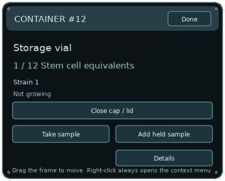

# Using the desktop laboratory

This guide describes the current **desktop laboratory** on main (also retained on desktop-laboratory-dev), including the simplified individual containers. The classic UI is optional and is not needed for the workflow below.

## Start the game

1. Download [Cellarium-Desktop-Laboratory-Windows.zip](../builds/desktop/Cellarium-Desktop-Laboratory-Windows.zip). On GitHub, use the file page's download button.
2. Extract the entire ZIP into a folder. Keep the DLL files beside the executable.
3. If another desktop build is running, choose **Exit Cellarium** from its tray menu first.
4. Open **Cellarium-Desktop-Laboratory.exe**.

Equipment appears on the desktop. The Cellarium icon is in the Windows system tray, possibly under the tray's hidden-icons arrow. No classic game window should open. Existing desktop-edition saves restore automatically.

## Mouse controls

| Action | Result |
|---|---|
| Left-click and hold, then move | Drag that piece of equipment. |
| Click without moving | Open its contents or working controls. |
| Click an embedded button | Perform the button's action without dragging. |
| Right-click | Open that object's context menu. It never automatically sucks material into the dropper. |
| **Done** on a container | Close its contents panel; keep the container and contents. |
| **Collapse** on the workstation/Forge | Return the instrument to its smaller desktop appearance. |

If something will not move, right-click it and check **Unlock position**. Equipment can move between monitors.

## Each container is its own container

Clicking a vial opens **that vial**, identified by the number in its header. It does not cycle through other vials. Its contents, quantity, cap, temperature and culture state belong to that persistent container ID.

There are no global inventory or vial selectors inside a container's panel. Browsing stock belongs to the workstation, Forge or central records application.

### The container buttons

| Control | What it does |
|---|---|
| **Open cap / lid** or **Close cap / lid** | Change access to this container. Transfers require an open, unfrozen container. |
| **Take sample** | Move one cell-equivalent sample from this container into the dropper. The container's quantity decreases. |
| **Add held sample** | Dispense the dropper's loaded sample into this container. It does not select material from elsewhere. |
| **Add food** | Replenish nutrients in this Petri dish, flask or plate. Growth runs automatically while food, viability and space permit. Storage vials do not grow cultures. |
| **Freeze this vial / Thaw this vial** | Preserve or thaw the contents of a cryovial. This is not shown on ordinary vials. |
| **Details / Less detail** | Show or hide this container's temperature, nutrients, health and contamination. Cultivation containers also offer medium refresh. |

The quantity is measured in simulated **cell equivalents**: counted sample units, not a claim that individual microscopic cells are visible on the desktop. The dish artwork represents colony patterns.

**Empty** means this particular container has no cells. **Stored sample** is normal for a storage vial. Cultivation containers show Food and an estimated **Next cell ~MM:SS** countdown. Empty, Needs food, Full and Frozen explain why there is no growth countdown.

Right-clicking a container offers **Show contents**, the applicable sample action, position locking and **Put away this container**. Putting it away hides/stores the object; it does not discard its contents. Restore it with the tray's **Restore Objects from Storage** action.

## First transfer: storage vial to Petri dish

In a fresh experiment, a storage vial contains the starting cell suspension and the dishes are empty. A restored experiment may have different contents.

1. Click the source vial. Check its ID and contents.
2. Open its cap if closed.
3. Click **Take sample**. The dropper now holds one sample, and the source count decreases by one.
4. Click an empty Petri dish and open its lid if needed.
5. Click **Add held sample**. A short droplet animation completes the transfer.
6. Check the dish's increased count. Growth starts automatically; use **Add food** when nutrients run low.

You can also right-click a source and choose **Take sample from this container**, or drag the dropper so its tip is inside the source and choose **Collect sample beneath tip** from the dropper's menu. To dispense by dragging, release the loaded dropper with its tip over the destination.

Only an explicit transfer moves material between containers. Opening or moving a different vial does not switch or merge their contents. The simulation clock is shared, so cultures can still grow over time, including while hidden.

### If a transfer is rejected

Read the feedback in the records window/status area or the tray notification. Common reasons are:

- The dropper is empty, or already holds a sample when you try to collect again.
- The source or destination is closed or frozen.
- The destination is full or has unsuitable culture conditions.
- The destination contains a different cell category or genome. Use a separate compatible container.

A rejected dispense keeps the sample in the dropper. To clean the dropper, right-click it and choose **Sterilize dropper** after dispensing or deliberately discarding its sample. Reusing it between strains without cleaning can carry contamination. Discarding is a separate, confirmed action.

## Use the cell workstation

Click the workstation to expand its controls **on the desktop**. It is a central preparation tool, so its selectors intentionally browse stock; they are not the contents panel of a vial.

To introduce a loose cell into a container:

1. Click the **Cell #… >** selector until the intended loose specimen is shown.
2. Click the container selector below it until the destination's exact **#ID** is shown.
3. Click **Introduce cell**. One loose specimen moves into that chosen container.
4. Click the physical container to inspect its own contents.

Other existing workstation actions include:

- **Collect wild cells**: add loose specimens to the laboratory stock.
- **Extract DNA**: archive a copy of the selected cell's genome; retain the source cell.
- **Send to Forge**: load the selected cell's genome copy into the desktop Forge.
- **Install into blank cell**: install the selected archived DNA into one blank developmental cell. The new cell appears in loose stock.
- **Buy 6 blanks / 8 credits**: replenish the finite blank-cell stock.
- **Feed selected culture**, **Withdraw cultured cell**, and **Preserve selected cell**: act on the displayed destination or loose specimen, as their labels indicate.
- **Egg precursor / Sperm precursor**: prepare reproductive material from a suitable stem cell. Precursors need time to mature.

Always check the displayed specimen and container IDs before pressing an action. Clicking **Collapse** only closes these expanded controls.

## DNA vials and the Genome Forge

A DNA vial contains **one specific archived genome template**, not a living cell culture. Clicking it shows only that record. **Use this DNA in the Forge** loads a copy of that exact vial's genome into the desktop Forge; it does not rewrite the vial or an organism.

For a basic edit:

1. Click a DNA vial and choose **Use this DNA in the Forge**. Alternatively, click the Forge, choose **Archived DNA** or **Living cells**, select a source, and click **Load editable copy**.
2. Choose **Primary**, **Development** or **Ecology**.
3. Select a chromosome/locus button, then change allele **A** or **B** with the minus/plus buttons. Values range from 0 to 3.
4. Use **Forecast** to view the predicted body and viability. Some edits can produce a nonviable body.
5. Choose the outcome you want:
   - **Archive DNA** creates a separate genome archive/DNA vial.
   - **Install cell** consumes one blank developmental cell and puts the engineered cell into loose stock for the workstation.
   - **Incubate exact** consumes one blank developmental cell and starts embryonic development from the edited genome.
   - **Export genome** writes the genome to this edition's save directory; the feedback reports its path.

**Undo** reverses the most recent draft edit. **Reset copy** reloads the selected source. These affect the draft, not the source container.

Advanced controls modify the real genome: **duplicate**, **delete**, **restore**, **regulate**, and **splice**. Regulation cycles a D12-based link through activation, suppression and off. Splicing uses the selected source. **Assemble 2 sources** combines the current draft with the selected source. These are central Forge operations, which is why the Forge has source selectors while individual vials do not.

## PC time and cultivation timers

There is no accelerated game-hour clock. One elapsed PC second is counted once. Age, culture growth, embryonic development, gamete maturation, physiology and lifespan use the same elapsed-time source. Existing balance durations are expressed in real minutes: a gamete precursor takes eight actual minutes; embryo development generally takes about 24–36 actual minutes depending on anatomy. The PC clock is shown in the records header, and durations use MM:SS or HH:MM:SS.

A culture's Next cell countdown is an estimate from its actual population, nutrients, temperature, health and genome. Nutrient use and stress can change that estimate. Cells divide repeatedly without harvesting or restarting a batch, while food and space remain. At capacity the container shows Full; removing a sample makes space and fed growth resumes. Refill food using Add food. Freezing is biological preservation, not a pause button for the laboratory.

Life continues while equipment is hidden. When the application is closed, its save timestamp and pending elapsed-time ledger are used to apply time away on the next launch. Long absences can naturally exhaust food or harm organisms; no short offline cap silently discards the elapsed time.

## Development, habitats and records

Incubation must complete before a viable organism is released. A forecast does not guarantee survival: anatomy, resources and environmental compatibility still matter.

Click a habitat to inspect it. The new records application provides **Incubation**, **Habitats**, **Records**, **Research** and **Cryobank** pages for detailed work, including feeding, environmental adjustments, organism inspection, genome/body records, breeding, preservation and research history. Access it through the tray's record entries or **Settings & Object Manager**. It uses the same simulation records as the desktop equipment.

Freshwater, saltwater and terrestrial habitats have different conditions. Moving an organism preserves its identity and biology, but an unsuitable environment can harm it. No combat system is enabled.

## Hide, save, restore and exit

Right-click the real Cellarium tray icon:

- **Show Laboratory**, **Show Habitats** and **Show Desktop Organisms** control independent visibility groups. Hiding is not deletion, and biology continues while the process runs.
- **Save Laboratory + Layout** saves the current experiment and arrangement.
- **Restore Saved Layout** restores the saved arrangement without replacing the biological contents.
- **Reset Layout…** moves equipment into visible positions after confirmation.
- **Restore Objects from Storage** brings back objects put away through their menus.
- **Exit Cellarium** saves this desktop edition and shuts down its equipment and tray icon.

Closing the separate records window returns it to the tray; it does not exit the game. **Ctrl+Q** exits when that window is focused. **Ctrl+Shift+L** is the recovery shortcut: it hides all desktop groups and opens Settings. Re-enable the groups from the tray afterward.

This desktop edition saves on exit and restores on launch in its own save identity, `cellarium-desktop-laboratory-dev`. It does not overwrite the earlier ecology/engineering editions' saves. The life simulation follows elapsed PC time, including hiding, sleep and later restarts. There are no pause, speed or offline-cap controls. The full time away is queued and synchronized in responsive batches; the status area shows synchronization when necessary. Backward clock changes never reverse life. On first upgrade from an older abstract-time save, existing progress is retained and PC tracking begins from that launch.

The **Classic interface** switch is optional in Settings. Leave it off to use the new desktop system. If enabled, **New UI** in its header returns to the new interface.

## Troubleshooting

| Problem | What to check |
|---|---|
| A vial seems to show someone else's stock | Check the header's container ID. Individual container panels have no stock selector. A selector ending in `>` belongs to a workstation, Forge or central records screen. |
| A container cannot move | Check its position lock. Drag the visible body or blank panel/frame area, not an action button. |
| Equipment is missing | Check tray visibility groups, Restore Objects from Storage, and Reset Layout. |
| New build will not start | Exit the existing desktop build from its tray menu first. |
| No new organism appears immediately | Check Incubation and Research for progress or a recorded developmental failure. |
| Blank-cell installation is unavailable | Restock blank cells at the workstation and select valid DNA. |
| A storage vial says Stored sample | It stores material. Move a sample to a cultivation-capable dish, flask or plate to grow it. |

See the [implementation and verification report](../DESKTOP-IMPLEMENTATION.md) for automated results and the remaining manual Windows compatibility checks. Automated checks do not establish that the game has no bugs.
